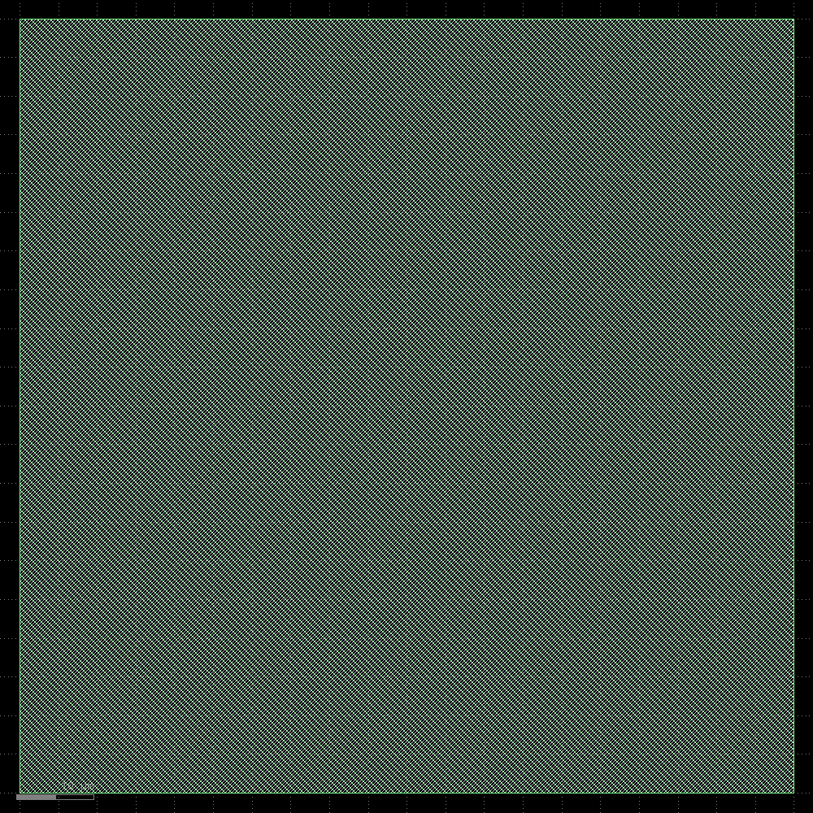
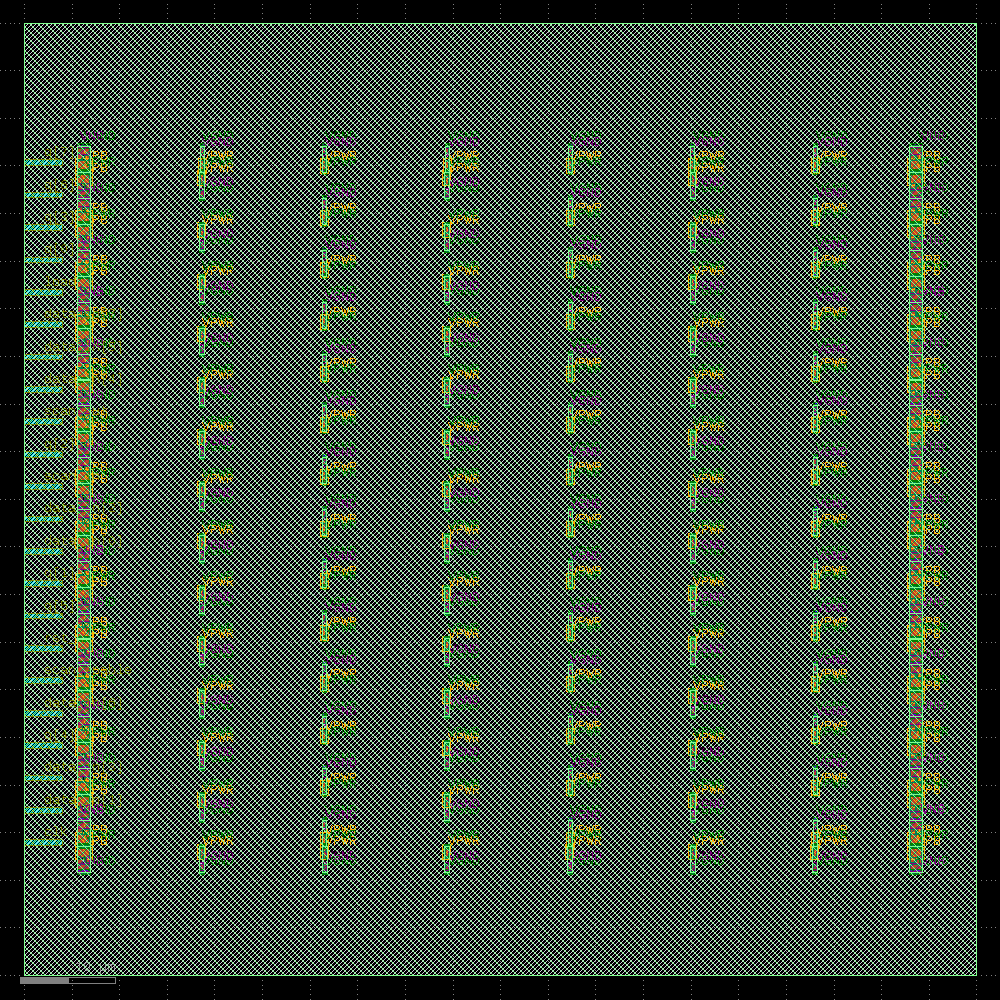
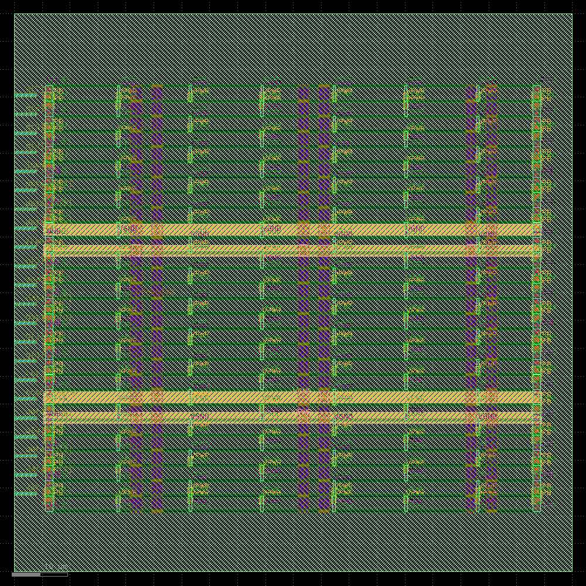
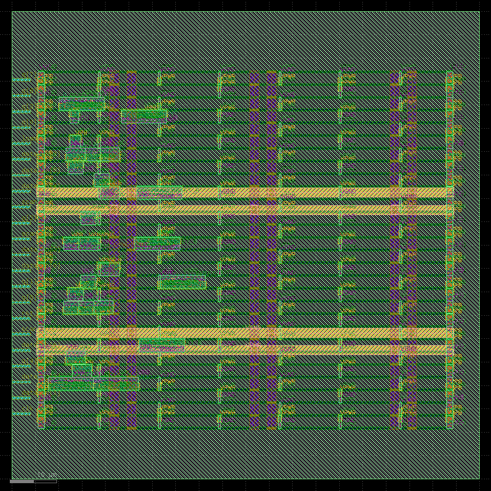

# Scan Register: RTL to GDS with SKY130

Educational physical implementation of an 8-bit scan register using **OpenLane 2.1.11**, SKY130A and `sky130_fd_sc_hd`. Executed in Google Colab with Yosys, OpenROAD/OpenSTA, KLayout, Magic and Netgen.

## Layout views

User-exported views from the implementation session. Captions describe visible structures; the images alone do not establish a specific completed flow stage. Exports 15 and 18 are identical and shown once.

| Floorplan grid | Tap/endcap and I/O structures |
|---|---|
|  |  |

| Power distribution structures | Standard cells and power distribution |
|---|---|
|  |  |

## Design

Active-low asynchronous reset, parallel load, serial scan shift and hold. Scan has priority over parallel load; `scan_out = q[7]`. The scan chain is described explicitly in RTL; this is not automated scan insertion.

Related functional verification and selected RTL fault-injection project: [DFT scan chain](https://github.com/hananeaouragh-ops/dft-scan-chain-fault-injection).

## Measured results

| Check | Result |
|---|---:|
| Clock target | 10 ns / 100 MHz |
| Die | 100 × 100 µm |
| Initial synthesis | 27 cells, including 8 flip-flops |
| Initial synthesis cell area | 390.3744 µm² |
| Magic DRC errors | 0 |
| Netgen LVS | Circuits match uniquely |
| Post-route setup worst slack, overall | +5.790308 ns |
| Post-route setup worst slack, register to register | +7.777767 ns |
| Post-route hold worst slack | +0.192603 ns |
| Setup / hold violations across 9 analyzed corners | 0 / 0 |

Timing uses extracted parasitics, a 10 ns clock, 2 ns input/output delays and 0.25 ns clock uncertainty. The 100 MHz target meets the analyzed constraints; this is not a measured silicon frequency or an Fmax characterization. Reset is timed using the default input-delay assumptions; integration requires an appropriate reset-release strategy.

## Flow

Synthesis → floorplan → tap/endcap insertion → I/O placement → PDN → global/detailed placement → CTS → global/detailed routing → fill → RC extraction → post-route STA → GDS stream-out → Magic DRC → SPICE extraction → Netgen LVS.

## Timing metric debug

The original report returned `inf` for register-to-register setup slack. Its query selected one worst path per endpoint before filtering for register origins; input-origin paths could hide register-origin paths. [The patch](patches/r2r-metric.patch) restricts the setup/hold metric queries to register output pins and register data pins. STA was rerun on the same extracted design, giving finite positive slack. It changes report selection, not RTL, placement, routing or timing constraints. Original global violation queries remain unchanged.

## Files and reproduction

- `rtl/`: source RTL.
- `constraints/implemented.sdc`: generated constraints from the recorded run.
- `reports/`: measured timing metrics, two representative corner reports, Magic DRC and Netgen LVS.
- `results/`: final netlist and encoded GDS with SHA-256 checksum.
- `scripts/run_flow.py`: reconstructed sequence used for the interactive implementation. This consolidated script has not been separately executed end to end.

Install OpenLane 2.1.11 and its matched tools/PDK using the [official notebook](https://github.com/chipfoundry/openlane2/blob/main/notebook.ipynb). In the OpenLane source checkout, apply `patch -p1 < /path/to/patches/r2r-metric.patch`, then run `python /path/to/scripts/run_flow.py` in that environment.

The binary GDS is stored as Base64 because publication used a text-file API. Reconstruct it with `python scripts/decode_gds.py`; the script checks its SHA-256 before writing `results/scan_register.gds`.

## Scope and known warnings

This is a small educational block, not a fabricated or foundry-qualified tapeout. No commercial signoff, silicon measurements, IR-drop/EM signoff, gate-level equivalence proof or ATPG coverage claim is made. LVS compares the final implementation netlist with the extracted layout, not RTL equivalence.

Logs include obsolete LEF syntax, unsupported LEF58 enclosure syntax, missing CCS noise templates and physical-only fill/tap/decap cells represented as timing black boxes. Magic DRC and LVS completed with the results above; these warnings and the limited verification scope must be considered for any further use. Zero router DRC errors alone is not foundry signoff.

Based on the OpenLane educational notebook. The included patch modifies its Apache-2.0-licensed Tcl code; upstream notices remain in the original source.
